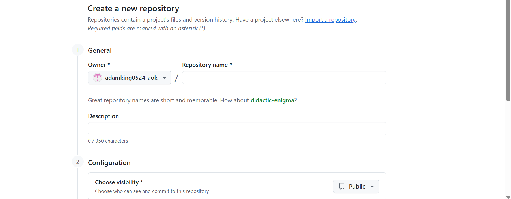
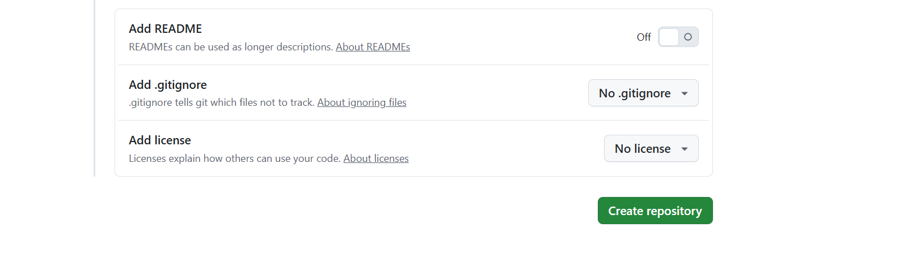

# Getting Started With GitHub

## Overview

GitHub is a platform that allows users to store, manage, and collaborate on projects using Git repositories.

This guide walks beginners through the process of creating a repository and adding their first file.

## Prerequisites

Before you begin, make sure you have:

- A GitHub account
- An internet connection
- A web browser

## Create a Repository

### 1. Open GitHub

Sign in to your GitHub account.

### 2. Start a New Repository

1. Select the **+** icon in the upper-right corner.
2. Select **New repository**.
3. Enter a name for your repository.
4. Enter a short description.
5. Select **Public**.
6. Select **Add a README file**.

*The GitHub New Repository screen where you enter your repository information.*

> **Tip:** A clear repository name makes it easier for you and others to understand what the project contains.

### 3. Create the Repository

Review your settings and select **Create repository**.

GitHub creates the repository and displays its main page.

## Add a File

After creating your repository, you can add files directly through GitHub.

1. Select **Add file**.
2. Select **Create new file**.
3. Enter a file name.
4. Add your content.
5. Scroll to the bottom of the page.

## Commit Your Changes

A commit records a change made to a repository.

To commit your new file:

1. Enter a short description of the change.
2. Select **Commit changes**.
3. Select **Commit directly to the main branch**.
4. Select **Commit changes**.

Your file is now saved in the repository.

## Verify Your Changes

Return to the repository's main page.

You should see the new file listed alongside the README file.

Select the file to open it and review its contents.

## Troubleshooting

### I cannot find the "New repository" option

Make sure you are signed in to GitHub. You can also access the repository creation page from your profile menu.

### My changes are not showing

Refresh the repository page and confirm that the changes were committed to the correct branch.

### I accidentally committed the wrong information

Open the file and select the edit option to make corrections. Create a new commit after making your changes.

## Summary

You have now created a GitHub repository, added a file, and committed your changes to the main branch.

These are some of the basic actions you will use when working with GitHub.
